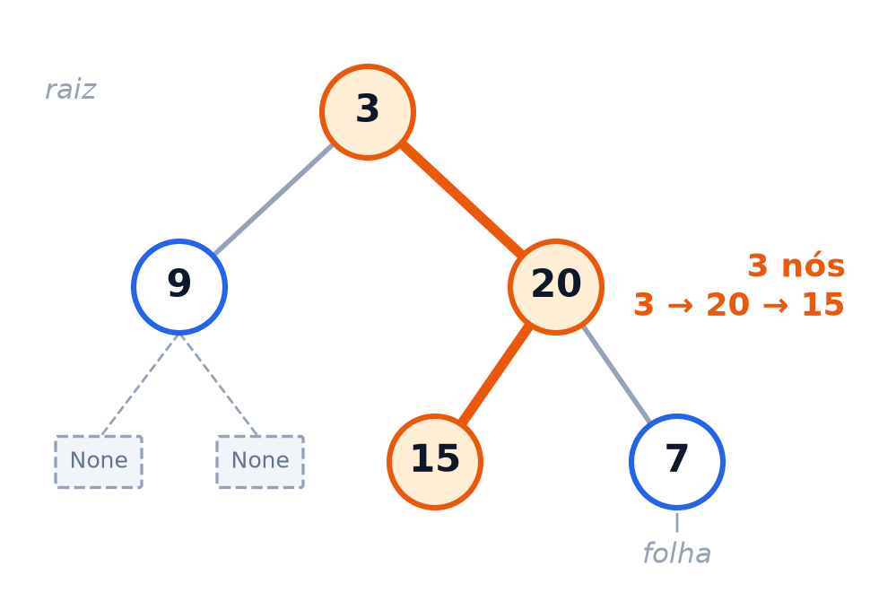
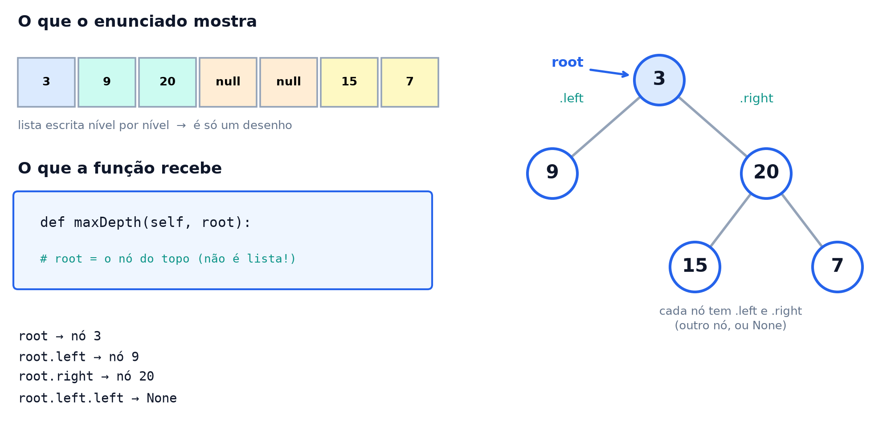
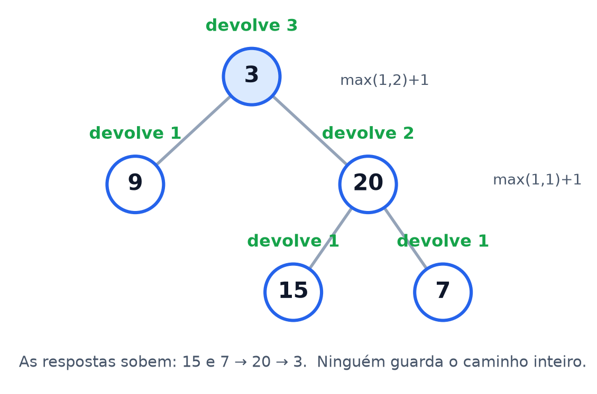
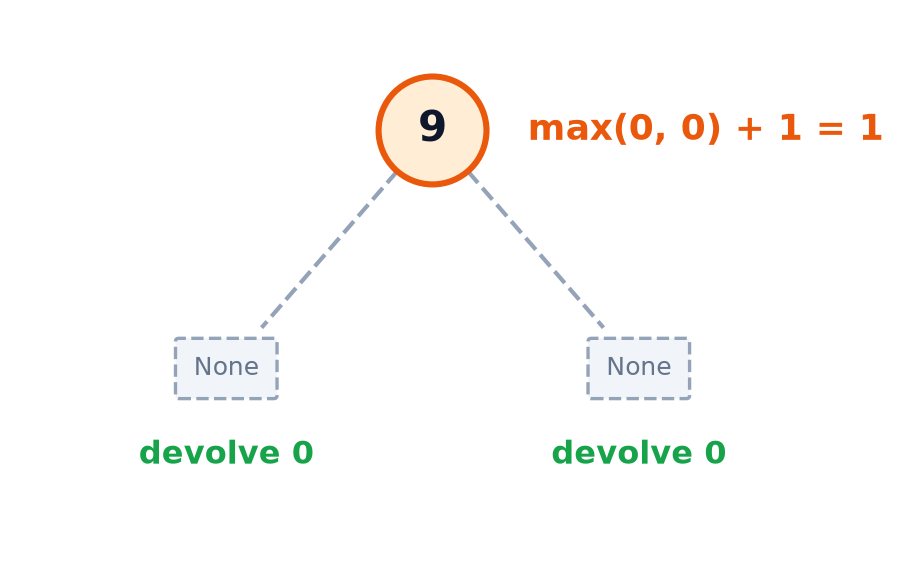
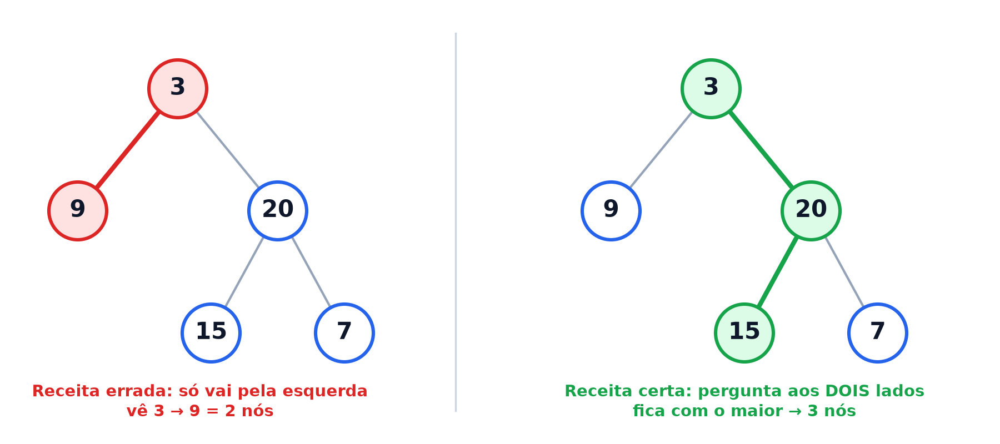

# 104. Maximum Depth of Binary Tree


Problema no LeetCode: <https://leetcode.com/problems/maximum-depth-of-binary-tree/>

## O problema

Dada a raiz de uma árvore binária, devolver a sua **profundidade máxima**: o número de **nós** no caminho mais longo que vai da raiz até uma folha.

| Entrada (lista do enunciado) | Saída | Caminho mais longo |
|---|---|---|
| `[3,9,20,null,null,15,7]` | `3` | `3 → 20 → 15` |
| `[1,null,2]` | `2` | `1 → 2` |
| `[]` (árvore vazia) | `0` | — |

> A contagem é em **nós**, não em setas. Uma árvore com um nó só tem profundidade 1.



## Entendendo a entrada

A lista que aparece no enunciado é só um **desenho** da árvore, escrito nível por nível, onde `null` significa "aqui não existe nó".

Na função, **não chega lista nenhuma**. Chega só `root`, o nó do topo, e a partir dele se alcança o resto seguindo as setas:

```
      3                 root          → nó 3
     / \                root.left     → nó 9
    9   20              root.right    → nó 20
       /  \             root.right.left  → nó 15
      15   7            root.left.left   → None (o 9 não tem filho esquerdo)
```



O valor guardado no nó (`val`) **não importa** para este problema. Só importa a forma da árvore.

## A ideia: delegar

Cada nó faz a mesma pergunta aos seus dois filhos: *"qual a profundidade da árvore que começa em você?"*. Cada filho repete o processo com os filhos dele e devolve **um número**. Ninguém precisa guardar o caminho inteiro.

A regra, em uma frase:

> **Um nó devolve o maior dos números que seus dois filhos devolveram, mais 1 (ele mesmo).**
> Um nó vazio (`None`) devolve **0**.

O `0` do vazio é o que faz a conta fechar para as folhas: `max(0, 0) + 1 = 1`.





## Solução

```python
class Solution(object):
    def maxDepth(self, root):
        if root is None:
            return 0

        E = self.maxDepth(root.left)
        R = self.maxDepth(root.right)

        return max(E, R) + 1
```

O código completo, com comentários, está em [`solution.py`](solution.py).

## Passo a passo no exemplo 1

Resolvendo de baixo para cima, como numa corrente de ligações em que cada nó espera a resposta dos filhos:

| Nó | `E` (esquerda) | `R` (direita) | Devolve |
|---|---|---|---|
| 15 | 0 | 0 | `max(0,0) + 1 = 1` |
| 7 | 0 | 0 | `max(0,0) + 1 = 1` |
| 9 | 0 | 0 | `max(0,0) + 1 = 1` |
| 20 | 1 (do 15) | 1 (do 7) | `max(1,1) + 1 = 2` |
| 3 | 1 (do 9) | 2 (do 20) | `max(1,2) + 1 = 3` |

Resposta: **3**.



## Complexidade

- **Tempo:** `O(n)`, cada nó é visitado uma única vez.
- **Espaço:** `O(h)`, onde `h` é a altura da árvore (as chamadas pendentes). No pior caso, uma árvore em fila, `h = n`.

## Armadilhas que encontrei no caminho

- **Tratar a entrada como lista** e tentar "pular posições". O código recebe um nó e anda com `.left` e `.right`.
- **Contar filhos** em vez de olhar o que cada filho devolveu. Dois nós com dois filhos podem devolver respostas diferentes.
- **Esquecer o `+ 1`** do próprio nó.
- **Achar que a chamada recursiva "termina tudo" ao devolver 0.** O nó que perguntou continua da linha em que parou e ainda precisa fazer o `return`.
- **Confundir `=` com comparação.** Para testar se o nó é vazio: `root is None`.
- **Esquecer o `self.`** ao chamar `maxDepth` de dentro da classe.

## Como rodar localmente

```bash
python testes.py
```

O arquivo [`testes.py`](testes.py) monta a árvore a partir da lista (no mesmo formato do LeetCode) e confere os exemplos do enunciado e alguns casos extras.

## Material de estudo

O guia ilustrado completo (9 páginas, com diagramas, o aquecimento de recursão e todas as dúvidas que tive pelo caminho) está em [`explicacao.pdf`](explicacao.pdf).
