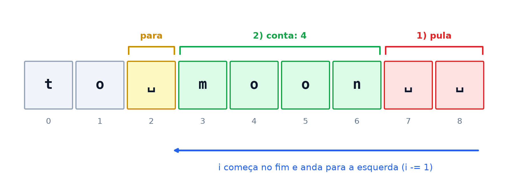
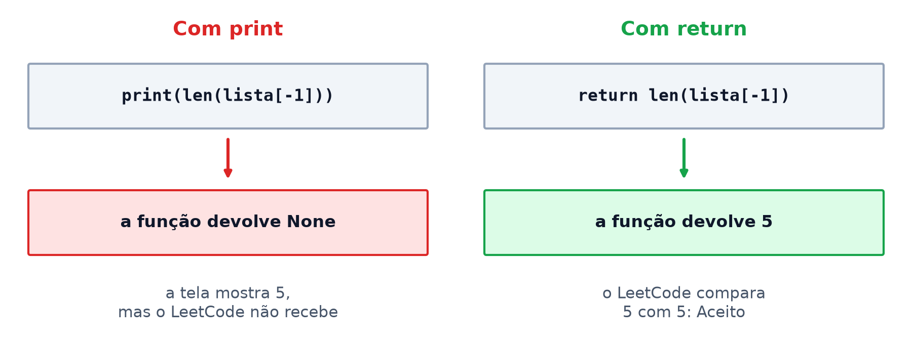

# 58. Length of Last Word (Comprimento da Última Palavra)


Problema no LeetCode: <https://leetcode.com/problems/length-of-last-word/>

## O problema

Dada uma string `s` com palavras e espaços, devolver o **comprimento da última palavra**. Uma palavra é uma sequência de caracteres que **não são espaços**.

| Entrada | Saída | Por quê |
|---|---|---|
| `"Hello World"` | `5` | a última palavra é `World` |
| `"fly me to the moon  "` | `4` | a última palavra é `moon` (há espaços sobrando no fim) |
| `"luffy is still joyboy"` | `6` | a última palavra é `joyboy` |

Restrições: `1 <= s.length <= 10^4`, `s` só tem letras do alfabeto inglês e espaços, e **sempre existe pelo menos uma palavra**.

## Minha primeira ideia

Identificar os espaços, descobrir qual é o **último** espaço e contar o que vem depois. A lógica está certa, mas implementada à mão (com vários `if` e um laço procurando espaço por espaço) vira um código grande. A pergunta que guiou o resto foi: **existe um jeito mais simples de dividir o texto nos espaços?**

## Dois caminhos

### Caminho A: dividir em uma lista de palavras

O método de string `split()` quebra o texto em uma lista de palavras. Sem argumentos, ele **separa por qualquer quantidade de espaços e ignora os espaços do começo e do fim**.

```python
"fly me to the moon  ".split()
# ['fly', 'me', 'to', 'the', 'moon']
```

Depois, basta pegar o último item (`lista[-1]`) e medir com `len()`.

![split() transforma o texto em lista e lista[-1] pega a última palavra](img/01_split.png)

### Caminho B: ler de trás para a frente

Como a última palavra é a primeira que se encontra vindo do fim, não é preciso dividir nada:

1. pular os espaços do final;
2. contar letras até chegar a um espaço (ou ao início da string).



## Solução (a que passou no LeetCode)

```python
class Solution(object):
    def lengthOfLastWord(self, s):
        lista = s.split()
        return len(lista[-1])
```

Resultado no LeetCode: **Aceito**, 3 de 3 casos, 0 ms.

## Solução alternativa (sem criar lista)

```python
class Solution(object):
    def lengthOfLastWord(self, s):
        i = len(s) - 1

        # 1) pula os espaços do final
        while s[i] == ' ':
            i -= 1

        # 2) conta as letras da última palavra
        tamanho = 0
        while i >= 0 and s[i] != ' ':
            tamanho += 1
            i -= 1

        return tamanho
```

Testei as duas versões com os exemplos do enunciado e com casos extras (`"a"`, `"a "`, `"   a   "`), e todas deram o resultado esperado.

## O erro que cometi no caminho

A primeira versão terminava assim:

```python
print(len(lista[-1]))
```

e **não passou**, mesmo com a lógica correta.

- `print` **mostra** um valor na tela, mas a função não entrega nada a quem a chamou (devolve `None`).
- O enunciado pede para **retornar** o valor, e o LeetCode compara o que a função **devolve** com a resposta esperada.

A correção foi trocar `print(...)` por `return ...`.



## O que dá para aprender com este desafio

1. **Antes de escrever muito código, procure uma ferramenta pronta.** Se a solução parece gigante, provavelmente a linguagem já tem um método para a parte chata (aqui, `split()`).
2. **`split()` sem argumentos já trata os espaços extras.** Espaços repetidos, no começo ou no fim, não geram itens vazios. Já `split(" ")` (com um espaço entre aspas) **geraria itens vazios** e quebraria o exemplo 2.
3. **Índice negativo conta de trás para a frente.** `lista[-1]` é o último item, `lista[-2]` o penúltimo, e assim por diante.
4. **`print` e `return` são coisas diferentes.** `print` é para o humano ler; `return` é para o programa receber o valor. No LeetCode, sempre `return`.
5. **Leia os exemplos como casos de teste, não só como ilustração.** O exemplo 2 tinha um espaço no fim de propósito, para pegar quem ignora esse caso.
6. **As restrições dizem o que não precisa ser tratado.** Como sempre há pelo menos uma palavra, `lista[-1]` nunca falha por lista vazia. Sem essa garantia, seria preciso conferir antes.
7. **Existe mais de um caminho, com trade-offs.** O caminho A é mais curto e legível; o caminho B usa menos memória.

## Complexidade

| | Tempo | Espaço |
|---|---|---|
| Caminho A (`split`) | `O(n)` | `O(n)` (cria a lista de palavras) |
| Caminho B (de trás para a frente) | `O(n)` no pior caso | `O(1)` |

## Armadilhas para lembrar

- Esquecer os **espaços no fim** da string (exemplo 2).
- Usar `split(" ")` em vez de `split()`.
- Usar `print` no lugar de `return`.
- No caminho B, esquecer de conferir `i >= 0` e passar do início da string.

## Como estudei este desafio

1. Entendi o enunciado e testei os exemplos à mão.
2. Escrevi a ideia em palavras (achar o último espaço e contar depois).
3. Procurei um jeito mais simples do que `if` por `if`.
4. Rodei, errei (`print` em vez de `return`), entendi o motivo e corrigi.
5. Documentei o que aprendi.

## Como rodar localmente

```bash
python testes.py
```

Os arquivos são [`solution.py`](solution.py), [`solucao_alternativa.py`](solucao_alternativa.py) e [`testes.py`](testes.py).

## Material de estudo

O guia ilustrado está em [`explicacao.pdf`](explicacao.pdf).
